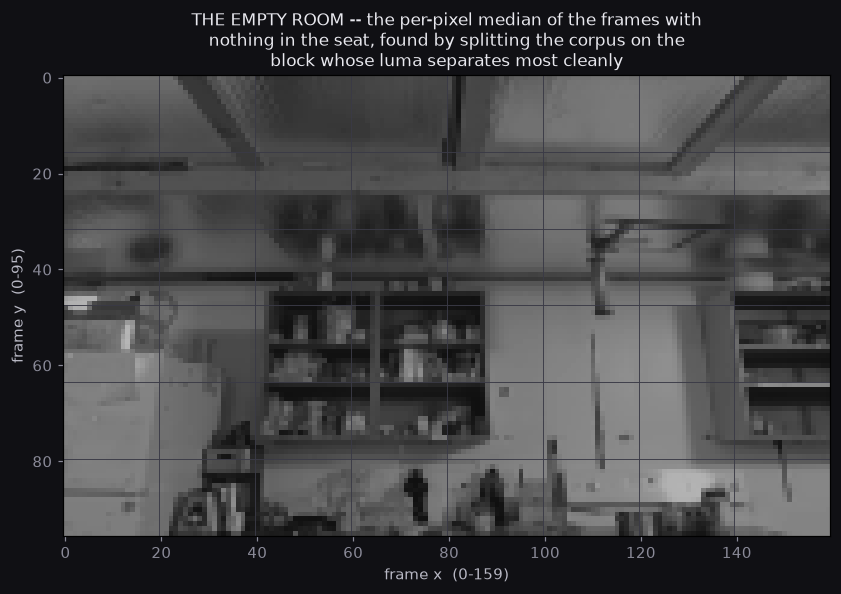
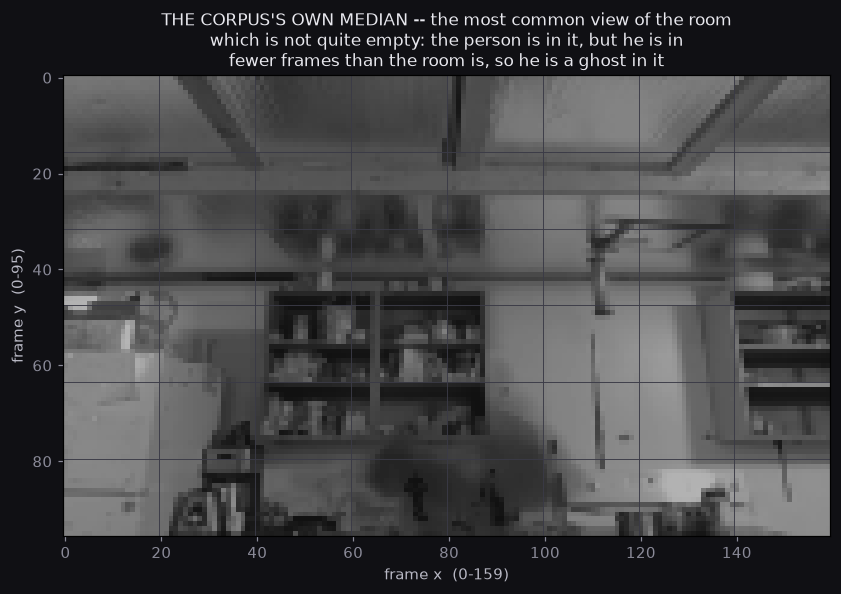
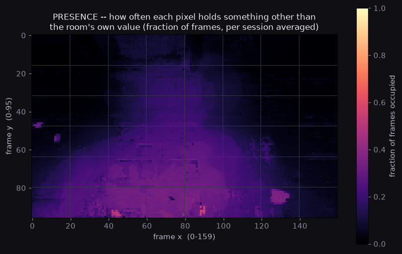
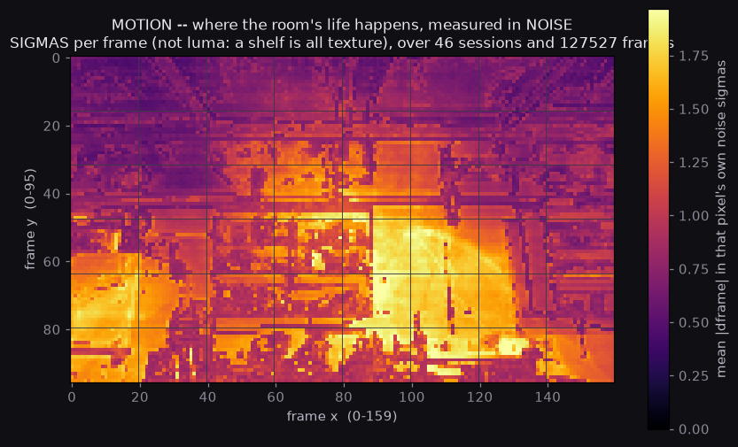
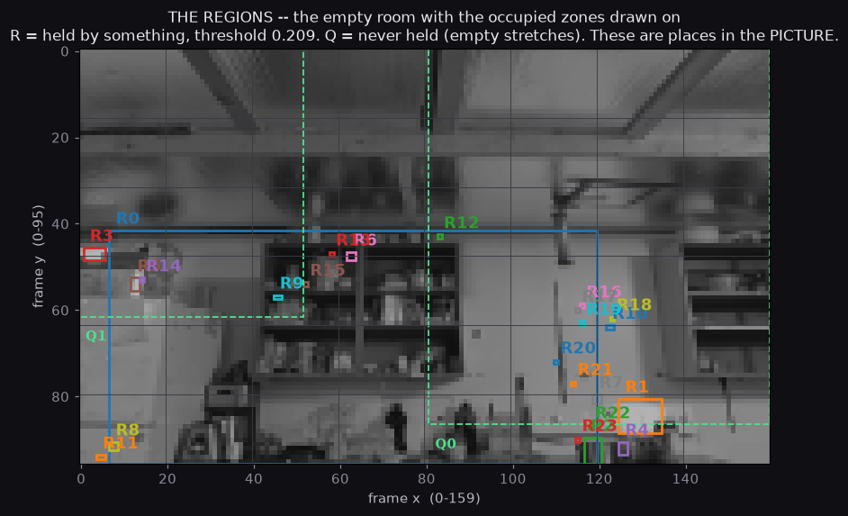

# ROOM MAP — the room as the camera knows it, and the three things that had to be found before it could be drawn

**Measured by:** `experiments/room_map.py` — local, numpy and matplotlib only,
no API and no network.
**Corpus:** `/mnt/c/proart_capture/corpus/free_sessions` — 50 sessions,
139,469 luma frames, 160x96, uint8 BT.601.
**The brief:** Casey's, 2026-10-20 night — *map the room from the video*.

---

## 0. THE HEADLINE

The room is mapped, and the picture is here beside this text. Three things
had to be found before it could be drawn, and all three were found by the
tool rather than assumed by the author.

**The empty room is not the corpus's median.** Over the capture, the person
was in front of the camera often enough that the most common view of the
room has him in it — not as a silhouette but as a smudge, about eleven
luma levels darker than the empty room in the place where his head and
shoulders are, and *brighter* than the empty room everywhere else. The
empty room has to be looked for. The tool finds it by splitting the corpus
on the block of the frame whose luma separates most cleanly into two
populations, and then calling the population whose *frames agree with each
other* the empty one — a room does not change and a person does.

**The camera is not quite fixed.** The laptop was nudged during the night,
by one pixel and then two, and a map built across the nudge is a map of two
slightly different pictures averaged into one. The tool measures every
session's shift against the composite and splits the corpus where the
measurement says to. 46 sessions, 127,527 frames are at one viewpoint; 4
sessions, 11,942 frames are at another, and they are reported separately
rather than averaged in.

**Two thirds of the frames are the same bytes twice.** The recorder writes
a frame only when the image has changed, so 42,221 of the 127,527 frames
in the mapped viewpoint are a genuinely new picture and the other 85,306
are repeats of the one before. A motion map that divides by the number of
frames is measuring how often the picture changed, not how much anything
moved. This map divides by the number of changes.

The three findings are worth more than the map itself, because each of them
was a way for the map to be quietly, confidently wrong.

---

## 1. WHAT WAS MEASURED

Fifty-three directories sit in the corpus folder. Three of them are probe
artifacts with no frames in them and are excluded, which leaves fifty
sessions: 49 triggered by motion, and one by hand — the one the corpus
night spent its time on, session `1792560597`, which is the only DRILLED
session in the corpus and is therefore also the only session whose class is
not AMBIENT.

| what | how much |
|---|---|
| sessions used | 50 (46 mapped, 4 at a second viewpoint) |
| frames | 139,469 total, 127,527 at the mapped viewpoint |
| frames that were a new picture | 42,221 of 127,527 |
| frame size | 160 x 96, uint8 BT.601 luma |
| empty frames measured for the noise | 16,100 |
| empty adjacent pairs measured for the motion noise | 17,195 |

The corpus format is the recorder's own: `luma.raw` is the frames
concatenated, and `meta.json` says so. The frame-to-frame difference is
the same quantity `motion_as_text.py` and `corpus_capture_win.py:change_maps`
already use, at full resolution here, because a heatmap wants the pixels and
not a 2x2 average.

---

## 2. THE CAMERA MOVED, AND THE TOOL FOUND OUT

The premise of a room map is one fixed camera. This one is nearly fixed,
and the exception is the kind that a median hides completely.

A nudge of one or two pixels moves the *edges* of everything in the frame
by one or two pixels and leaves the middle of every surface exactly where
it was. A per-pixel median over the whole corpus therefore produces an
image that looks perfectly sharp and is actually two pictures averaged
together. Worse, the residual against that composite is large along every
edge in the nudged sessions and small everywhere else, so a presence map
built across the nudge lights up the furniture of half the room.

So the corpus is split by where it was shot from, and the split is
measured:

* each session is compared against the composite at every shift in a
  window of four pixels in each direction, and the shift that agrees best
  is kept;
* the comparison is made on the **top band of the frame** — ceiling and
  beam, and never a person. A person in the frame would drag the score
  and turn the measurement from a question about place into a question
  about occupancy;
* the sessions are split at the **largest gap in the sorted scores**, which
  is the same move the empty-room split makes, for the same reason: a gap
  in a distribution is a boundary, and a threshold placed by eye is not.

The scores come out with one clear gap in them: forty-six sessions score
0 to 2, and four sessions score 7 to 12. The gap is 5.0.

| session | frames | shift (y, x) | score |
|---|---|---|---|
| 1792560758 | 9,260 | −1, 0 | 11.0 |
| 1792560597 | 1,626 | −2, 0 | 11.0 |
| 1792560773 | 934 | −2, 0 | 12.0 |
| 1792560124 | 122 | +1, +4 | 7.0 |

The three largest of those are the three real sessions from the corpus
night — the ones the speech-to-score work and the person profile were
built on. They were shot from a laptop that had been nudged down one pixel
and then two. The map is built over the 46 sessions that agree, and those
four are reported here rather than mixed in.

The cost of getting this wrong is measurable: against the mixed composite,
the median absolute residual of a nudged session's frames is about 27 luma
levels, against about 1 for a session at the mapped viewpoint. One of them
reads as the whole frame being occupied, everywhere, all the time.

---

## 3. THE EMPTY ROOM IS FOUND, NOT ASSUMED

The corpus's most common view of the room is not an empty room. The
person is at the desk more often than not, so the plain median over every
frame has him in it. The empty room has to be found, and the tool finds it
without being told what a person looks like:

* the frame is divided into a grid of 8 x 6 blocks;
* for each block, the per-frame mean luma is gathered across the corpus,
  and the block whose distribution splits most cleanly into two populations
  is chosen (Otsu's between-class variance ratio);
* the two populations are the frames with something in that block and the
  frames without;
* the population with the **tighter spread** is the empty one, because a
  room does not change and a person does.

That is the only assumption in the chain, and it is an assumption about
the physics rather than about what Casey looks like.

| what | value |
|---|---|
| the winning block | `[3, 5]` — x 60-79, y 80-95 |
| Otsu between-class ratio | 5,503.9 |
| the split | at 59.429 luma, gap-refined |
| the empty population | the **high** one |
| frame agreement, low population | 14.87 |
| frame agreement, high population | **5.50** |
| ambiguous? | no — the two differ by a factor of 2.7 |

The winning block is the strip of desk directly under where Casey sits,
and the empty frames are the ones where that strip is clear.



**What the empty room is**, read off the composite: a ceiling with coffers
and beams across the top (y 0-20); a rail at y 22-45 with bags hanging
from it (x 30-80); a flat bright panel down the left (x 0-28, y 48-95); a
bookshelf (x 42-80, y 45-72); a blank wall (x 82-115); a vertical stand at
x 105-110 running from the rail to the desk; a shelving unit on the right
(x 130-160, y 45-72); and the desk itself along the bottom (y 78-96),
with a dark machine at x 28-45, small objects around x 75-95, and a lamp
at x 125-134.



The second image is the corpus's own median over the mapped viewpoint, and
it is the reason the empty room had to be found: there is a person in it.
He is not there as a silhouette — the median of a picture he was in front
of half the time is a smudge, not a portrait. Measured, the zone where his
head and shoulders are is 11.1 luma levels darker in the median than in
the empty room, while the right-hand shelving is 6.1 luma levels
*brighter*. The difference is him, and it is the only difference.

---

## 4. THE NOISE, AND THE UNITS IT HAS TO BE IN

Every occupancy test needs a threshold, and a threshold needs a scale to
be measured against. Getting the units of that scale wrong is the single
most effective way to produce a map that looks fine and measures nothing.

The first version of this tool measured the per-pixel noise on **raw
luma** and then applied it to an **exposure-corrected residual**. Those
are not the same quantity. The threshold came out at 182 to 298 luma
levels, above the top of the 8-bit range, so no pixel in the frame was
ever occupied: the presence map came out flat and black, 24 regions of a
few pixels each, and nothing in the picture at all.

The fix is a rule rather than a fudge: **the noise is measured in the same
units as the test that uses it.** The noise is measured on the empty
frames, against the same composite, with the same exposure fit, and the
occupancy threshold is that noise times six, with a floor of four luma
levels for the pixels whose own noise is nearly zero.

| quantity | value |
|---|---|
| presence noise, per pixel | 1.23 luma at the median, 8.15 at the worst |
| the occupancy threshold it produces | about 7.4 luma levels, at the median pixel |
| motion noise, per pixel | 0.61 luma at the median |

The noise is measured with a **median absolute deviation**, not a standard
deviation. The empty frames are not perfectly empty — a person standing
somewhere else in the room would still be in them — and a standard
deviation is dragged up by exactly the frames that matter.

**The exposure fit is robust, and it has to be.** The thing being fitted
out is often the very thing the measurement is about. Casey at the desk is
a big dark mass covering a quarter of the frame. A plain least squares fit
lets that mass pull the slope down: the gain comes out at 0.45, and every
pixel of the frame is then left sitting thirty luma levels away from the
room. So the fit starts from statistics a quarter of the frame going dark
cannot move — the gain from the ratio of the two pictures' robust spreads,
the offset from the difference of their medians — and is then refined on
the pixels that *agree* with the room, because the occluder is exactly
what did not agree.

---

## 5. THE PRESENCE MAP

How often each pixel holds something other than the room's own value: the
fraction of frames in which the occupancy test fires, averaged per session
and then across the sessions, so that a 15,514-frame session does not
drown out a 502-frame one.



The picture is legible. There is a **head and shoulders** in the lower
middle-left of the frame, with a bright patch at the bottom right that is
the lamp, and the whole of the upper frame is black — never occupied by
anything at all.

---

## 6. THE MOTION MAP

The same corpus, the other half of the question: where does the room
*change*.

The first version of this map was a **texture map**. It was the mean
absolute difference between neighbouring frames, per pixel, and a
bookshelf is all edges and noise, so the bookshelf scored high, and a
blank wall scored low, whether or not anything moved in front of either.
The busiest pixel in the corpus was a spot on the desk, and the picture
looked like a picture of the room's furniture rather than a picture of
the room's life.

Two corrections turn it into the thing that was asked for:

* it is divided by **that pixel's own noise**, so the unit is noise sigmas
  per frame and a textured shelf and a blank wall can be compared;
* it is divided by the number of **changes**, not the number of frames,
  because the recorder writes a frame only when the picture changed and
  two thirds of the frames in this corpus are repeats of the one before.
  Without this, a room where nothing ever moves and a room where
  something is always moving average into the same map.



The result is the room's life with the furniture taken out. The hottest
area is the person's own silhouette, the second hottest is the lamp, and
the ceiling — which is smooth, and which nothing ever happens in front of
— is cold.

---

## 7. THE REGIONS, AND WHAT THEY ARE CALLED

**The threshold is derived, not chosen.** The presence map is *graded*,
not bimodal: a person's edge fades into the room, because the shoulder is
in front of the desk in one frame and beside it in the next, and the
pixels in between are occupied a third of the time rather than never. The
map's histogram is a broad shoulder with a long tail and **no valley** to
put a threshold in. Otsu splits it at 0.145, which selects a third of the
picture and fuses the person with every stray pixel on the walls.

So the threshold is a quantile of the map, stated in the words the map can
be read in: **the occupied zone is the quarter of the picture that holds
the most occupancy.** That is the 75th percentile, 0.2090, and it selects
25.0% of the frame. The tool takes `--threshold` so a reader who wants a
different quarter can have one, and the JSON carries the histogram so the
choice can be argued with.



Twenty-four regions are found. Three of them are places, and the rest are
specks:

| region | frame bounds | area | presence | motion | the room's own luma | what it is |
|---|---|---|---|---|---|---|
| **R0** | x 7-119, y 42-95 | 24.15% | 0.277 | 1.32 | 80.6 | **the person zone** |
| **R1** | x 125-134, y 81-88 | 0.42% | 0.331 | 1.74 | 172.5 | **the desk lamp** |
| R2 | x 117-120, y 90-95 | 0.12% | 0.255 | 1.02 | 69.3 | the desk edge beside the lamp |
| R3-R23 | various | ≤0.065% each | 0.21-0.29 | 0.9-1.9 | — | 21 specks, 1-10 pixels each |

The names are the report's, not the tool's — the tool says where in the
picture each region is, and the reasoning is here so it can be checked.
Each name rests on three independent things: what the region measures,
what the composite shows underneath it, and what the corpus's own median
shows.

**R0 is the person zone.** Its presence is 0.277 — it held something for
better than one frame in four, over two thirds of the night. The presence
map shows a head and shoulders, not a rectangle: the outline curves. The
corpus's median has a ghost of the same shape in the same place. The block
that the empty-room split chose on its own — x 60-79, y 80-95 — is inside
it. And the region is 24% of the frame, which is about what a person
sitting two feet from a laptop camera covers.

**R1 is the desk lamp.** It is the most frequently occupied region in the
room (0.331), and it changes harder than anything else does: 1.74 noise
sigmas per change against 1.32 for the whole of the person zone, which is
what a lamp does — it is either on or it is not, and when it is on it is
brighter than the room by a hundred luma levels. It sits on the brightest
patch of surface in the composite (172.5 luma). Three independent
measurements agree, and the composite shows the lamp itself there. (The
single hottest pixel in the whole motion map is not on the lamp, though: it
is at x 89, y 67, which is the person's own chest.)

**The desk zone is not a region, and that is the finding.** The desk runs
along the bottom of the frame from x 20 to x 160 at y 78-96, with the dark
machine at x 28-45 and the lamp at x 125-134. It is where the room's life
is — but it does not appear as a separate occupied region, because the
person sits at it. The desk and the person are the same region in this
picture, and the tool cannot tell them apart from the video alone.

**The door is not in the evidence.** The brief asked for a door. The
closest candidate in the composite is the flat bright panel down the left,
x 0-28, y 48-95, and the honest answer is that **the corpus does not
support the name**. The panel is featureless: no frame edge, no handle, no
kick plate, no change of angle. It lies entirely inside the quiet region
Q1 — nothing ever passed in front of it, and nothing ever moved in it. A
door, a whiteboard, a blank wall catching the light, and a picture of a
door are the same picture from one camera at this angle, and the tool is
built so that it says so rather than guessing. If a door is in that room,
this map cannot see it.

---

## 8. THE EMPTY STRETCHES

An empty stretch is a measurable thing: a connected piece of the frame
where the presence never rose above one frame in twenty (0.05).

| stretch | frame bounds | area | mean presence | what it is |
|---|---|---|---|---|
| **Q0** | x 81-159, y 0-86 | 21.54% | 0.022 | the right half of the room |
| **Q1** | x 0-51, y 0-61 | 14.92% | 0.017 | the ceiling, the rail, and the left panel |

Q0 is the blank wall, the vertical stand and the right-hand shelving: a
third of the room's width, in which nothing ever happened for two hours.
Q1 is the ceiling and the left-hand panel: the coffers, the rail with the
bags hanging from it, and the flat bright surface that would be a door if
the corpus could tell.

Between them, **36% of the picture is a place where nothing ever happened.**
That is the strongest single fact this map carries, and it is not visible
in any single frame.

---

## 9. THE HONESTY CLAUSE

**This is the room as the camera knows it — image-plane truth, not a floor
plan.** Every coordinate in this document is a place in a picture. x runs
from 0 to 159 and y from 0 to 95, and a frame coordinate is a place in the
image, not a place in the world. Nothing here measures a distance. Nothing
here can tell a door from a picture of a door, a wall from a mirror, or a
shelf from a hole in the wall with boxes in front of it. The camera sees this
room from one angle; it cannot see behind anything, and it cannot see the
room at all.

Three more limits belong in the same breath as the clause:

* **The map is about one viewpoint.** 46 of the 50 sessions, and the four
  that are not are reported rather than mixed in. A map of the nudged
  viewpoint would be a different map, and this is not it.
* **The corpus is not a sample of a life.** It is one night, one room, one
  person, mostly in a small number of poses. The map says where the room's
  life was held *on this night*. It is not a map of where a room's life
  is held.
* **The presence map counts frames, and the frames are not independent.**
  Two thirds of them are duplicates. A thing that happened once and was
  then held for ten minutes is one event, not six hundred events.

---

## 10. WHAT A SECOND ANGLE WOULD ADD

A second camera would answer, in one afternoon, the questions this map
cannot answer at all.

**It would turn the image plane into a place.** Two views of the same
room is the minimum for depth. Every coordinate in this map is currently
ambiguous between "two feet away" and "twenty feet away", and a second
angle ends that ambiguity by triangulation. The distance from the camera
to the desk, the distance from the camera to the whiteboard, the width of
the gap between the bookshelf and the right-hand shelving — all of it is
one extra camera and a matching calibration, and none of it is available
now.

**It would break the degeneracy of the silhouette.** The person zone R0 is
twenty-four percent of the frame, and a single camera cannot tell a person
from a large dark object in the same place. The move-as-text work already
has the machinery for motion events; with a second angle, the same event
could be checked for consistency in both views, and the check itself
would be the classifier.

**It would make the viewpoint problem a solved problem rather than a
detected one.** The laptop was nudged once or twice in a night, and the
tool had to notice. A camera bolted to the wall does not have this
problem, and neither does a second camera that can see the first one
move.

**What it would not add.** It would not change the presence map's
statistics, which are about this camera's view of this room. It would not
tell us what the room is for. And it would not make the door legible on
its own — it would need a second angle *of the left panel*, from a
position that can see its edge, because a door is an edge and an edge is
a thing you can only see if something is behind it.

The phone node riff (`docs/research/ideation/PHONE-NODE-mcode.md`) is the
version of this idea that fits the existing fleet, and its proof is the
same thing this map needs: two independent fixes of one point whose
disagreement is the error bar.

---

## 11. WHAT THE SONAR WOULD ADD

The sonar was measured on the same corpus on the same night and it
closed with a number rather than an answer — the chain above 15 kHz is not
measurable on this hardware, and the return sits 87 to 94 dB below the
stimulus (`docs/research/ROOM-SONAR-REPORT.md`).

**The two maps are orthogonal, and that is why the second one is worth
having.** The camera map is image-plane truth: where things are, in
pixels, with no distances and no occlusion. A room measurement is
metric: how far the walls are, how long the reverberation is, whether the
room is bigger than it looks. A single camera cannot recover a distance
from a picture at all; a microphone does not care about angles.

**What a working sonar would add to this map.** The room's dimensions,
which would let every coordinate here be given a scale. The reverberation
time, which would say whether the hard ceiling and the hard floor are
doing what they look like they are doing. The reflection pattern of the
back wall, which would turn the flat bright panel on the left from "a
featureless rectangle" into "a surface at four metres with a specular
reflection in it" — and a specular reflection is one of the few things
that can distinguish a door from a picture of a door, because a picture
of a door does not reflect.

**The honest order of operations.** The sonar is the harder measurement
and it is the one that is currently blocked by the hardware. The camera
map is the one that works tonight. So the camera map is what gets built,
and the sonar's first job is not to map the room at all — it is to find
out why the chain above 15 kHz is dead, because a loopback, a louder and
longer sweep, or a voice-band marker would each say in one measurement
which of the microphone, the speakers and the room is at fault. A room
measurement does not need ultrasound; the microphone hears the room
perfectly well below 8 kHz, and the same reflections would be there.

**What the sonar would not add.** It would not tell us where in the room
the person was, or what they were doing. It has no idea. The two
measurements answer different questions, and the room map would still
need the camera after the sonar works.

---

## 12. WHAT WOULD KILL THIS MAP

In the order I would worry about them.

* **A camera that moves.** It already did, twice, and the map already had
  to be split because of it. A map is only as stable as the thing it is
  looking at.
* **A change of light.** The exposure fit assumes the camera's own
  auto-exposure is the only thing changing the frame's level, and it
  handles that well. It would not handle the room's lights being switched
  on at two in the morning, which would change the shadow under the desk
  as well as the level. The empty-room split would break, and it would
  break quietly.
* **A second person.** The empty-room test asks whether the population's
  frames agree with each other. Two people moving independently make the
  occupied frames agree *less*, which helps the split. But the composite
  would be built from a room with one person's clutter in it, and the
  presence map would report that clutter as furniture forever.
* **Frame rate.** The motion map divides by the number of changes, and the
  number of changes depends on the encoder. At a different frame rate the
  same motion would produce a different count, and the map's units —
  noise sigmas per change — would quietly mean something else.
* **The threshold.** The region threshold is a quantile of the map, and a
  quantile is not a property of the room. On a night when Casey was away,
  the same rule would select a completely different quarter of the picture.
  The map underneath it would be unchanged; the *regions* would not be.

---

## 13. HOW TO REPRODUCE THIS

```bash
# the measurement and the images (about three minutes with the corpus
# cached in memory; it holds 2.7 GB of frames)
cd /home/proart/projects/communicator-acceptance
/home/proart/projects/gpu-venv/bin/python experiments/room_map.py \
  --out docs/research

# the checks that need no corpus
/home/proart/projects/gpu-venv/bin/python experiments/room_map.py --selftest

# re-draw the pictures from a saved measurement, without reading the
# corpus again
/home/proart/projects/gpu-venv/bin/python experiments/room_map.py \
  --redraw docs/research/room_map.json --out docs/research
```

The tool writes `docs/research/room_map.json` with every number in this
document: the split and its ratios, the per-session viewpoint scores and
shifts, the per-pixel noise maps, the presence and motion maps, the
histogram the threshold was taken from, and every region with its bounds
and its measurements.

The device was local throughout: numpy and matplotlib, no API, no network,
no GPU. The only external dependency is the corpus itself.

---

Committed for Muse to review; not merged.
