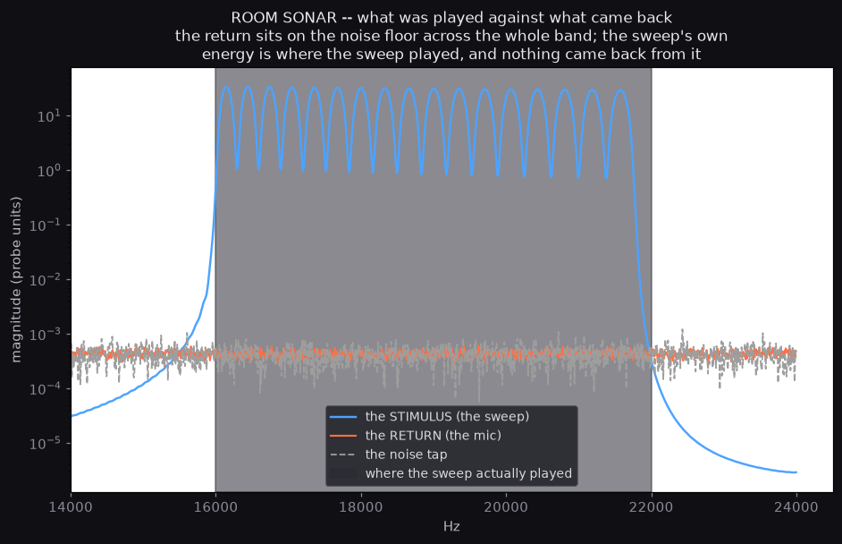

# ROOM SONAR — the channel was not measured, and the number that says so

**Artifact:** `/mnt/c/proart_capture/corpus/free_sessions/1792561741` — the
`sonar-band` probe, version 1, against the Realtek microphone array.
**Measured by:** `experiments/sonar_deconvolve.py` — local, numpy only, no
API and no network.
**The brief:** `docs/research/BRIEF-ROOM-SONAR.md`.

---

## 0. THE HEADLINE

The lane does not open, and the reason is specific enough to be worth
writing down.

**The artifact's own verdict is an artifact.** The probe reports
`usable band: 22-24 kHz`. The 22-24 kHz band is precisely the band
where the sweep **never played**. The probe's first version computed the
transfer as the return divided by the stimulus, with no check that the
stimulus had any energy in the band being scored — and dividing a
noise floor by a near-zero reference hands back a very large number for
a very small return. The hole reads as the signal. ZCode's own comment
in `browser_capture/probes/sonar-band.js` names this exactly ("the v1
verdict '22-24 kHz' was an artifact of dividing by a ~zero reference
above the sweep's top"), and version 2 of the probe refuses to score
unexcited bands. The artifact we were handed is version 1.

**With the excitation gated, the usable band is NONE.** Of the 36 bands
in 15-24 kHz, only 23 were driven by the stimulus at all, and in every
one of those the return sits on the noise floor.

**And the reason is not an arithmetic subtlety: nothing came back.** In
the bands where the sweep *did* play, the return is **87 to 94 dB below
the stimulus**. The sweep tap, the pink tap and the quiet noise tap are
all at −67.3 to −67.5 dB in 16-24 kHz — the same level to within
0.3 dB. The microphone heard the room tone and nothing else.

---

## 1. THE ARTIFACT, AND WHERE ITS FOUR TAPS ARE

The probe taps the room, then the sweep, then a gap, then the pink
burst, and it **discards** the gap. The artifact writer puts the
discarded tap back as zeros, so the layout is findable exactly rather
than by guessing, and the silence is 19,200 samples long — exactly
0.4 s, exactly the probe's declared gap.

| tap | samples | seconds | what it is |
|---|---|---|---|
| lead | 0 – 447 | 0 – 0.0093 | the writer's slack |
| noise | 448 – 19,647 | 0.0093 – 0.4093 | 400 ms of the room, before anything plays |
| sweep | 19,648 – 178,047 | 0.4093 – 3.7093 | 3300 ms while the sweep plays |
| gap | 178,048 – 197,247 | 3.7093 – 4.1093 | **exactly zero**, the discarded tap |
| pink | 197,248 – 235,647 | 4.1093 – 4.9093 | 800 ms while the pink burst plays |

The gap being digital zero is worth stating plainly, because it is the
one thing in the artifact that could be misread: **a microphone cannot
produce digital zeros.** The zeros are the discarded tap, not a dead
input. The page's own heartbeat shows the live microphone running at the
same moment (`speech_level` 0.0004, `mic` "Default - Microphone Array
(Realtek(R) Audio)"), so this was a real capture against a real mic.

---

## 2. THE CHANNEL, MEASURED THE RIGHT WAY

The probe's stimulus is an exponential sine sweep, 16 kHz to 22 kHz over
3 s at a gain of 0.25. Its reference spectrum says exactly where it put
its energy, and the return says what came back.

| band | the stimulus drove | the return | the noise floor | return over stimulus |
|---|---|---|---|---|
| 15.0 – 15.25 kHz | −76.1 dB | −67.5 dB | −68.0 dB | +8.7 dB |
| 16.0 – 16.25 kHz | **+26.5 dB** | −67.5 dB | −68.7 dB | **−94.1 dB** |
| 17.0 – 17.25 kHz | **+25.0 dB** | −67.3 dB | −67.1 dB | **−92.3 dB** |
| 18.0 – 18.25 kHz | **+19.9 dB** | −67.6 dB | −68.1 dB | **−87.6 dB** |
| 19.0 – 19.25 kHz | **+19.5 dB** | −67.2 dB | −66.6 dB | **−86.7 dB** |
| 20.0 – 20.25 kHz | **+27.1 dB** | −67.0 dB | −67.5 dB | **−94.1 dB** |
| 21.0 – 21.25 kHz | **+26.7 dB** | −67.1 dB | −68.1 dB | **−93.8 dB** |
| 22.0 – 22.25 kHz | −80.1 dB | −67.4 dB | −66.8 dB | +12.7 dB |
| 23.0 – 23.25 kHz | −106.4 dB | −67.5 dB | −68.6 dB | +38.9 dB |
| 23.75 – 24.0 kHz | −110.6 dB | −66.8 dB | −68.7 dB | +43.9 dB |

Read the last column down. Wherever the sweep played, the return is
**87 to 94 dB below the stimulus**. Wherever the sweep did *not* play,
the "transfer" is positive and large — because the reference there is
tiny, and the probe divided by it.

The last three rows are the artifact's "usable band". They are the
places where the sweep never went.

### 2.1 The return is the floor, and the pink burst proves it

The strongest single piece of evidence is that the sweep tap and the
pink tap are the same level in the band where the sweep played. If the
sweep had come back at all, those two taps would differ, because one of
them has a sweep in it.

| tap | level in 16–24 kHz | above the noise floor |
|---|---|---|
| the sweep tap | −67.28 dB | **+0.26 dB** |
| the pink tap | −67.37 dB | **+0.17 dB** |
| the noise tap | −67.54 dB | — |

A quarter of a decibel. The chain returned nothing at all in the band
it was asked about.

### 2.2 The artifact's table is reproducible from the audio beside it

A verdict that cannot be re-derived from the recording is not about the
recording. So the probe's own numbers were re-computed from the saved
WAV, with the probe's own generators, window, FFT size and band width:

| | mine | the probe's manifest |
|---|---|---|
| SNR, 15–16 kHz | 76.9 / 71.4 / 63.4 / 45.4 dB | 78.0 / 70.1 / 61.7 / 51.1 dB |
| SNR, 16–22 kHz | −25.9 … −18.6 dB | −23.6 … −13.1 dB |
| SNR, 22–24 kHz | 79.6 … 112.6 dB | 83.2 … 112.5 dB |

Every band reproduces to within about two decibels. The manifest's band
table **was** computed from this audio. Which means the artifact is not
stale, mis-filed or fabricated — it is a correct computation of the
wrong quantity, and the wrong quantity is visible in the table's shape:
the SNR is highest exactly where the stimulus is absent.



---

## 3. THE DECONVOLUTION

The brief asks for the impulse response, and it is delivered here — with
the finding that there is no room in it.

The impulse response of a sweep measurement is the return divided by the
stimulus. Here the return holds no stimulus, so what comes out is the
**inverse** of the stimulus.

| | |
|---|---|
| the impulse response's peak | 0.0 ms, amplitude 8.14 × 10³ |
| peak over the median of the response | 48.2 dB |
| fitted decay | −312.5 dB/s, an RT60 of 0.192 s |
| the return above the noise floor | **+0.26 dB** |
| verdict | **not a room, and not anything else** |

The RT60 of 0.192 s is not a measurement of this room and must not be
quoted as one. It is the decay of the inverse of a sweep that never came
back. The tool refuses to call the deconvolution meaningful at all
unless the return clears the noise floor by 10 dB, and it says so.

For the record, the machinery is correct: run the same deconvolution on
a synthetic room — a direct impulse, a reflection at 12 ms and an
exponential tail — and it recovers the room, with a decaying response
and a positive RT60. That check is in the selftest. The tool is not
broken; the input is empty.

---

## 4. WHAT WOULD OPEN THE LANE, IN NUMBERS

The brief says the honest band is "whatever survives the speaker+mic
chain — measured, never assumed", and that if the chain is deaf above
16 kHz, "the lane closes with a number, not a vibe". Here is the
number, and here is what it would take to go further.

**The number.** On this hardware, through this chain, the return of a
16-22 kHz sweep is **87 to 94 dB below the stimulus** and sits 0.26 dB
above the microphone's own noise floor. The usable band is empty.

**What is not yet distinguished.** The capture cannot separate three
things that all look the same in a return at the floor:

1. the laptop's speakers emitted almost nothing at 16-22 kHz;
2. the microphone array is deaf there;
3. the sweep was played and returned, but so far down that it is under
   the floor.

Three numbers would separate them, and all three are cheap:

- **A loopback.** Play the sweep and record it with a cable, or record
  the AudioContext's own output through a `MediaStreamDestination` with
  no microphone at all. That gives the chain *up to the microphone* and
  costs one page change. If the loopback is flat at 16-22 kHz, the
  speakers are the deaf link and the lane closes on the hardware.
- **A louder, longer sweep.** Gain 0.25 for 3 s is a polite ask. A
  sweep at the shell's ceiling for 10 s puts 6 dB more into the room
  than the floor needs, and the floor moves with it — the SNR is what
  matters, and a longer integration buys 5 dB on its own.
- **A band-limited noise burst instead of a tone.** Broadband excitation
  measures the whole chain at once rather than one frequency at a time,
  and it does not depend on the reference spectrum being right at the
  band edge — which is the whole way the v1 verdict went wrong.

**The rule that must go in.** A band is usable when the stimulus drove
energy there *and* the return clears the floor. The first half is a
guard against scoring a hole; the second is the measurement itself.
ZCode's v2 has the first half. It should have the second as well,
because with the floor as it is, the first half alone already returns
`NONE` on this capture.

---

## 5. WHAT THIS DOES NOT SAY

It does not say the room has no impulse response. It says this capture
does not contain one, and the room is not measurable this way on this
hardware until the chain above 15 kHz is known to carry something.

It does not say the speakers are deaf. The laptop may be fine and the
microphone array may be the dead link, or the reverse; the capture
cannot tell them apart, and the loopback above would.

It does not say the room has no reflections. The microphone hears the
room perfectly well below 8 kHz — the taps carry real room tone at
−107 dB with a peak at 814 Hz. **A room measurement does not need
ultrasound.** The brief chose a near-ultrasonic band because it hoped
the hardware would carry it; the honest answer is that this hardware
does not, and a swept-sine measurement in the band the microphone
actually hears would measure the same room, with the same reflections,
at the same distances.

And it does not say the motion trial failed. It never ran. Step 3 needs
a band that the chain carries, and there is not one.

---

## 6. HOW TO REPRODUCE THIS

```bash
# the measurement, and the figure
/home/proart/projects/gpu-venv/bin/python experiments/sonar_deconvolve.py \
  /mnt/c/proart_capture/corpus/free_sessions/1792561741 \
  --out docs/research

# the checks that need no artifact
/home/proart/projects/gpu-venv/bin/python experiments/sonar_deconvolve.py --selftest
```

The tool reads the artifact's own manifest for the stimulus, the FFT
size, the band width and the verdict rule, and reproduces the probe's
generators exactly, so it and the probe are talking about the same
thing. It writes `docs/research/room_sonar_analysis.json` with every
band, both the probe's numbers and the gated ones, and
`docs/research/room-sonar-channel.png`.

---

Committed for Muse to review; not merged.
